# Лабораторна робота №4. Початкове навантажувальне тестування

*Згенеровано `make_report.py` 2026-11-09 09:20. Усі числа нижче взято з CSV у `results/`.*

## 1. Мета

Створити та виконати базові сценарії навантажувального тестування API «Multidimensional Portal Generator» (розрахунок викривлених траєкторій порталів), зібрати метрики продуктивності (RPS, латентність, частка помилок, CPU/RAM сервера) і визначити перші вузькі місця системи.

## 2. Інструмент та обґрунтування

**Locust 2.47.0** (Python). Сценарії пишуться звичайним Python-кодом — тією ж мовою, що й застосунок, тож легко генерувати реалістичні дані, працювати з JWT і перевіряти тіло відповіді. JMeter вимагає GUI/XML-планів і важчий у підтримці; k6 (JavaScript) і Gatling (Scala/Java) швидші як генератори, але додають другу мову в проєкт. Для MVP-навантаження в сотні VUsers продуктивності Locust (gevent) достатньо, а headless-режим з `--csv`/`--html` дає все потрібне для звіту.

## 3. Тестове середовище

| Параметр | Значення |
|---|---|
| Система | FastAPI + SQLAlchemy (async) + PostgreSQL 16, JWT (HS256), bcrypt |
| Запуск | `docker compose` (сервіси `db`, `backend`, `client`); backend = `uvicorn src.main:app` (1 воркер) + `ProcessPoolExecutor` для обчислень |
| URL | `http://localhost:8000` (порт 8000 проброшено з контейнера `backend`) |
| Хост | Linux 7.0.0-42-generic, 8 CPU, 7.5 ГБ RAM |
| Docker | Docker 29.8.1, VM: 8 CPU, 1.78 ГБ RAM |
| Генератор навантаження | Locust 2.47.0, Python 3.12.3, на тому ж хості (один процес) |
| Моніторинг | `monitor.py --mode docker` (`docker stats --no-stream`, інтервал ≈ 2 с) |

> Генератор і система працюють на одній машині, тому частина CPU хоста витрачається на Locust — абсолютні числа є нижньою оцінкою можливостей сервера.

## 4. Профіль навантаження

Детальний план — [`docs/test_plan.md`](docs/test_plan.md).

| Прогін | VUsers | Spawn rate | Тривалість | wait_time |
|---|---:|---:|---:|---|
| `run_10u` | 10 | 5/с | 3.0 хв | between(1, 3) с |
| `run_50u` (основний) | 50 | 5/с | 5.0 хв | between(1, 3) с |
| `run_100u` | 100 | 5/с | 3.1 хв | between(1, 3) с |
| `run_200u` | 200 | 5/с | 3.2 хв | between(1, 3) с |

## 5. Сценарій

Кожен віртуальний користувач у `on_start` реєструє власний акаунт (`POST /auth/register`) і логіниться (`POST /auth/login`), зберігаючи JWT. Далі виконує зважені задачі з паузою 1–3 с:

| Задача | Запит | Вага | Що перевіряється |
|---|---|---:|---|
| Перегляд профілю | `GET /users/me` | 6 | 200 і `id` збігається з власним |
| Розрахунок траєкторії | `POST /simulations/run [geodesic]` | 4 | 201, кількість точок = max(8, complexity·8)+1, `user_id` свій |
| Трансформація координат | `POST /simulations/run [coordinates]` | 1 | 201, довжина масиву збігається |
| Оновлення профілю | `PUT /users/[id]` | 1 | 200, новий email збережено |
| Повторний логін | `POST /auth/login` | 1 | 200 і наявний `access_token` |
| Перевірка RBAC | `GET /admin/dashboard (expect 403)` | 1 | звичайний користувач отримує 403 |

Дані випадкові: `complexity` 1–10 (70%), 11–50 (25%), 51–100 (5%); `dimension_id` 1–1000; `initial_speed` 0–5000; `object_mass` 0.1–10 000; масиви координат 3–60 елементів. Відповіді валідуються через `catch_response`, динамічні URL згруповані через `name=`.

## 6. Результати

### 6.1 Зведення по прогонах

| VUsers | Запитів | RPS (середнє) | RPS (плато) | Avg, мс | Median, мс | p95, мс | p99, мс | Max, мс | p95 плато, мс | Помилки, % | CPU backend max / avg, % | RAM backend max, МБ |
|---:|---:|---:|---:|---:|---:|---:|---:|---:|---:|---:|---:|---:|
| 10 | 803 | 4.5 | 4.7 | 308.6 | 18 | 870 | 6 700 | 8 094 | 660 | 0.00 | 151 / 37 | 119 |
| 50 | 3584 | 12.0 | 12.7 | 2 148.9 | 1 100 | 5 500 | 33 000 | 60 006 | 3 400 | 0.39 | 144 / 97 | 157 |
| 100 | 352 | 1.9 | 2.1 | 45 496.1 | 57 000 | 60 000 | 60 000 | 60 023 | 60 000 | 94.60 | 106 / 99 | 113 |
| 200 | 439 | 2.3 | 4.0 | 60 007.7 | 60 002 | 60 000 | 60 000 | 60 036 | 60 000 | 100.00 | 102 / 100 | 95 |

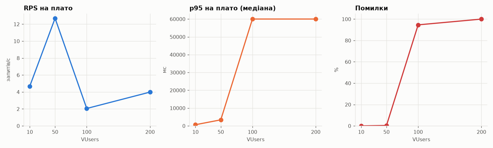

### 6.2 Прогін `run_50u` — основний

Метрики по ендпоінтах (Min/Max — точні, перцентилі — апроксимація Locust):

| Ендпоінт | Запитів | RPS | Avg, мс | Min, мс | Median, мс | p95, мс | p99, мс | Max, мс | Помилки, % |
|---|---:|---:|---:|---:|---:|---:|---:|---:|---:|
| GET /admin/dashboard (expect 403) | 237 | 0.79 | 1210.2 | 8.2 | 1000 | 3900 | 5600 | 8209.3 | 0.0 |
| POST /auth/login | 299 | 1.0 | 3475.8 | 653.1 | 1600 | 17000 | 29000 | 30229.5 | 0.0 |
| POST /auth/register | 64 | 0.21 | 31880.8 | 15.4 | 33000 | 56000 | 60000 | 60006.2 | 21.88 |
| POST /simulations/run [coordinates] | 246 | 0.82 | 1468.7 | 15.4 | 1300 | 3700 | 6500 | 7002.0 | 0.0 |
| POST /simulations/run [geodesic] | 1003 | 3.35 | 1810.9 | 17.7 | 1400 | 4900 | 13000 | 32525.7 | 0.0 |
| PUT /users/[id] | 232 | 0.78 | 1579.3 | 14.5 | 1200 | 4300 | 6500 | 11574.8 | 0.0 |
| GET /users/me | 1503 | 5.03 | 1191.7 | 7.8 | 690 | 3300 | 12000 | 28623.0 | 0.0 |
| **Усього** | 3584 | 11.99 | 2148.9 | 7.8 | 1100 | 5500 | 33000 | 60006.2 | 0.39 |

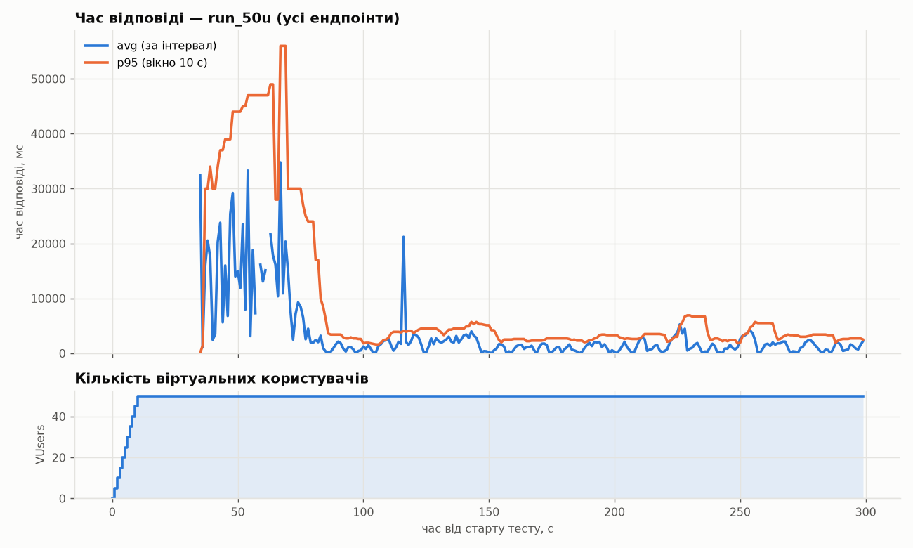

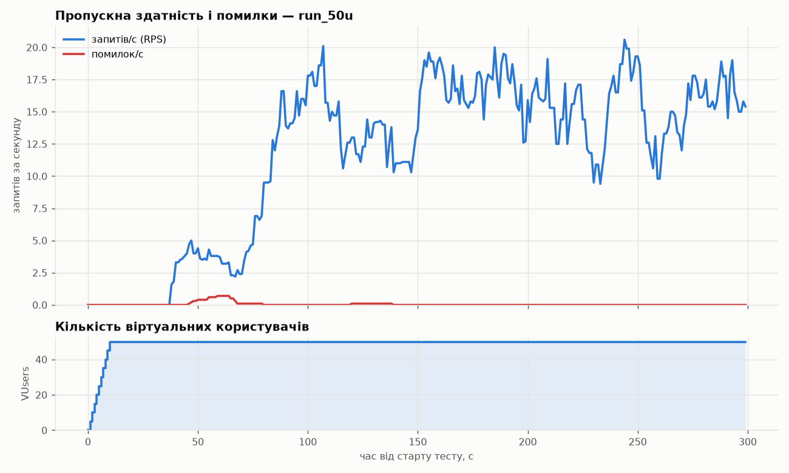

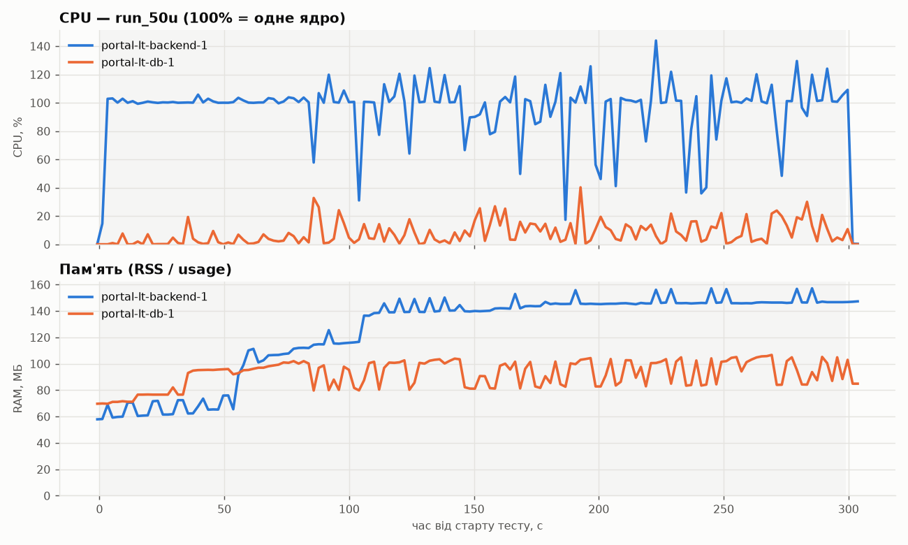

Помилки:

| Запит | Помилка | К-сть |
|---|---|---:|
| `POST /auth/register` | 'register: HTTP 500 {"message":"An internal server error occurred."}' | 7 |
| `POST /auth/register` | 'register: HTTP 0 ConnectionError' | 5 |
| `POST /auth/register` | 'register: HTTP 0 ReadTimeout' | 2 |

Виключення в лозі backend за час прогону:

| Виключення | К-сть |
|---|---:|
| `sqlalchemy.exc.TimeoutError: QueuePool limit of size 5 overflow 10 reached, connection timed out, timeout 30.` | 14 |
| `AttributeError: module 'bcrypt' has no attribute '__about__'` | 1 |

HTML-звіт Locust: [`results/run_50u.html`](results/run_50u.html)

### 6.3 Прогін `run_10u`

Метрики по ендпоінтах (Min/Max — точні, перцентилі — апроксимація Locust):

| Ендпоінт | Запитів | RPS | Avg, мс | Min, мс | Median, мс | p95, мс | p99, мс | Max, мс | Помилки, % |
|---|---:|---:|---:|---:|---:|---:|---:|---:|---:|
| GET /admin/dashboard (expect 403) | 66 | 0.37 | 156.6 | 8.6 | 10 | 570 | 5900 | 5873.5 | 0.0 |
| POST /auth/login | 56 | 0.31 | 1358.5 | 648.3 | 680 | 6400 | 8100 | 8094.0 | 0.0 |
| POST /auth/register | 10 | 0.06 | 7226.1 | 6718.3 | 7700 | 7700 | 7700 | 7739.7 | 0.0 |
| POST /simulations/run [coordinates] | 61 | 0.34 | 220.3 | 15.9 | 20 | 670 | 7300 | 7339.7 | 0.0 |
| POST /simulations/run [geodesic] | 212 | 1.19 | 117.3 | 16.1 | 24 | 580 | 1500 | 2442.9 | 0.0 |
| PUT /users/[id] | 52 | 0.29 | 351.1 | 14.8 | 20 | 1400 | 6600 | 6598.3 | 0.0 |
| GET /users/me | 346 | 1.94 | 94.2 | 7.8 | 10 | 530 | 1100 | 3395.7 | 0.0 |
| **Усього** | 803 | 4.51 | 308.6 | 7.8 | 18 | 870 | 6700 | 8094.0 | 0.0 |

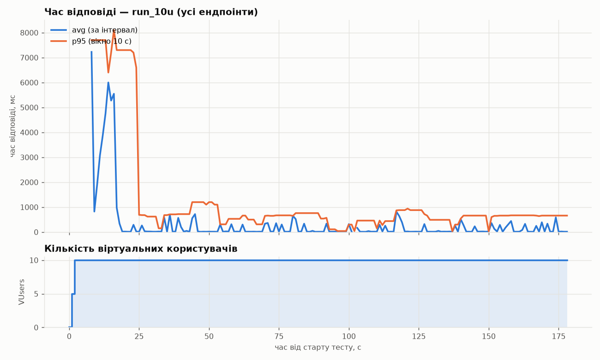

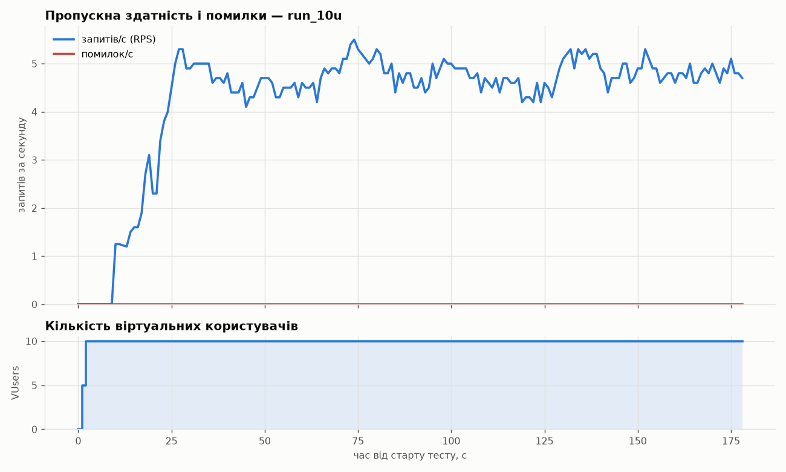

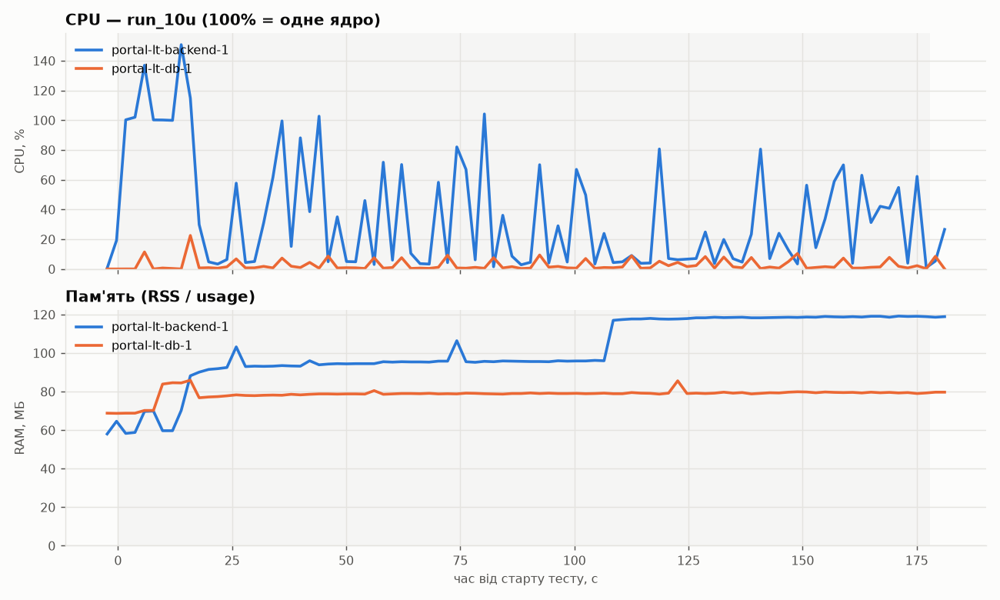

Помилки:

Помилок не зафіксовано.

HTML-звіт Locust: [`results/run_10u.html`](results/run_10u.html)

### 6.3 Прогін `run_100u`

Метрики по ендпоінтах (Min/Max — точні, перцентилі — апроксимація Locust):

| Ендпоінт | Запитів | RPS | Avg, мс | Min, мс | Median, мс | p95, мс | p99, мс | Max, мс | Помилки, % |
|---|---:|---:|---:|---:|---:|---:|---:|---:|---:|
| POST /auth/login | 4 | 0.02 | 1582.4 | 677.6 | 1900 | 2500 | 2500 | 2481.9 | 0.0 |
| POST /auth/register | 348 | 1.84 | 46000.9 | 164.6 | 57000 | 60000 | 60000 | 60022.8 | 95.69 |
| **Усього** | 352 | 1.86 | 45496.1 | 164.6 | 57000 | 60000 | 60000 | 60022.8 | 94.6 |

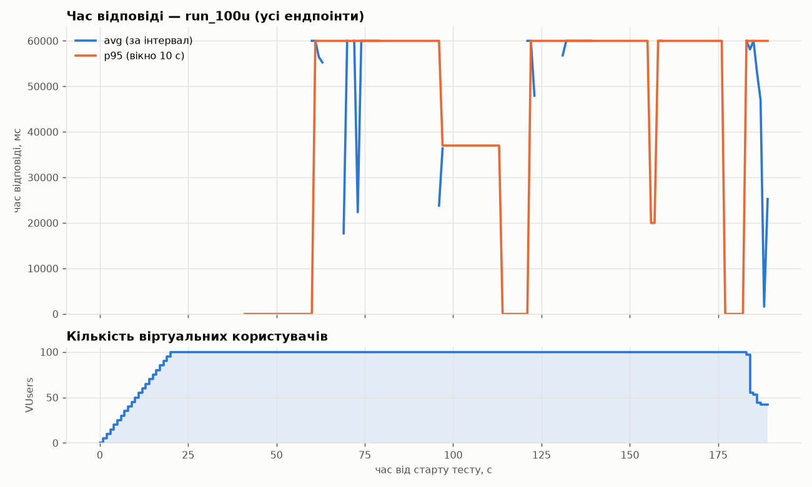

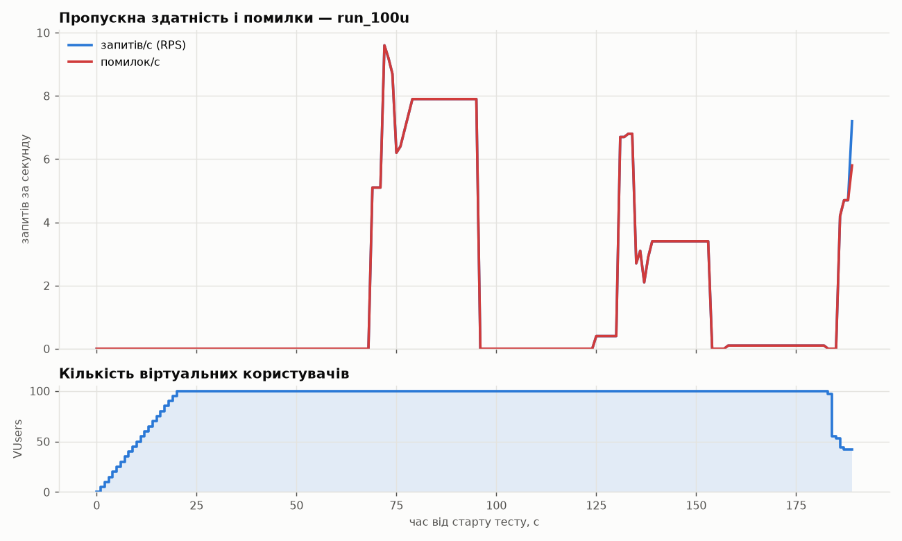

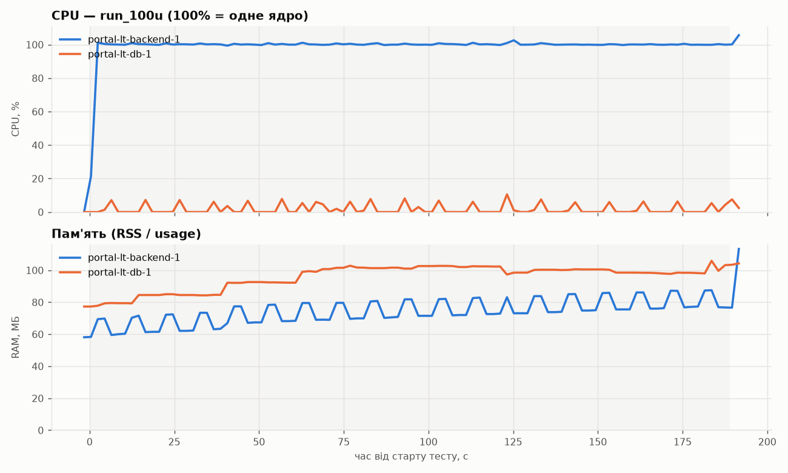

Помилки:

| Запит | Помилка | К-сть |
|---|---|---:|
| `POST /auth/register` | 'register: HTTP 500 {"message":"An internal server error occurred."}' | 125 |
| `POST /auth/register` | 'register: HTTP 0 ReadTimeout' | 122 |
| `POST /auth/register` | 'register: HTTP 0 ConnectionError' | 75 |
| `POST /auth/register` | 'register: HTTP 409 {"detail":"Email already registered"}' | 11 |

Виключення в лозі backend за час прогону:

| Виключення | К-сть |
|---|---:|
| `sqlalchemy.exc.TimeoutError: QueuePool limit of size 5 overflow 10 reached, connection timed out, timeout 30.` | 406 |
| `AttributeError: module 'bcrypt' has no attribute '__about__'` | 1 |

HTML-звіт Locust: [`results/run_100u.html`](results/run_100u.html)

### 6.3 Прогін `run_200u`

Метрики по ендпоінтах (Min/Max — точні, перцентилі — апроксимація Locust):

| Ендпоінт | Запитів | RPS | Avg, мс | Min, мс | Median, мс | p95, мс | p99, мс | Max, мс | Помилки, % |
|---|---:|---:|---:|---:|---:|---:|---:|---:|---:|
| POST /auth/register | 439 | 2.31 | 60007.7 | 60002.0 | 60002.00920400039 | 60000 | 60000 | 60036.0 | 100.0 |
| **Усього** | 439 | 2.31 | 60007.7 | 60002.0 | 60002.00920400039 | 60000 | 60000 | 60036.0 | 100.0 |

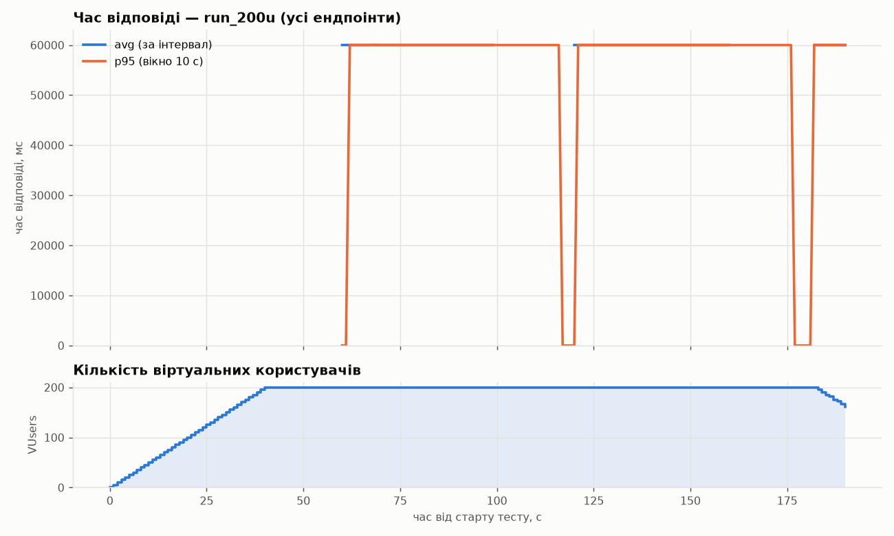

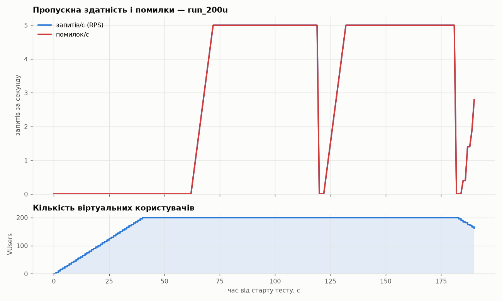

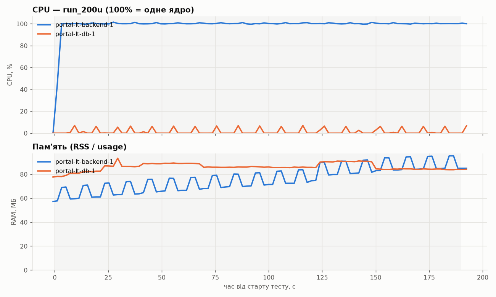

Помилки:

| Запит | Помилка | К-сть |
|---|---|---:|
| `POST /auth/register` | 'register: HTTP 0 ReadTimeout' | 439 |

Виключення в лозі backend за час прогону:

| Виключення | К-сть |
|---|---:|
| `sqlalchemy.exc.TimeoutError: QueuePool limit of size 5 overflow 10 reached, connection timed out, timeout 30.` | 250 |
| `AttributeError: module 'bcrypt' has no attribute '__about__'` | 1 |

HTML-звіт Locust: [`results/run_200u.html`](results/run_200u.html)

## 7. Виявлені вузькі місця

- **Найповільніший ендпоінт (run_50u):** `POST /auth/register` — p95 = 56 000 мс, avg = 31 880.8 мс, max = 60 006 мс. Далі: `/auth/login` (p95 17 000 мс), `/simulations/run [geodesic]` (p95 4 900 мс).
- **Автентифікація домінує у часі відповіді:** середній час `/auth/*` = 8 484 мс проти медіани ~1 200 мс для решти ендпоінтів. За кодом (`src/auth.py`) `hash_password`/`verify_password` — синхронний bcrypt, який викликається всередині `async def` і блокує єдиний event loop uvicorn; поки йде хешування, чекають усі інші запити — це пояснює «хвіст» p95/p99 у легких ендпоінтів (`/users/me`, `/admin/dashboard`).
- **Ємність автентифікації:** мінімальний час `/auth/login` у `run_10u` = 648 мс — це ціна одного bcrypt на вільному event loop, тобто сервер здатен виконати лише ~1.5 bcrypt-операцій/с. Розгін 5 VU/с потребує ~10 операцій/с (register + login), тож черга росте швидше, ніж обробляється, доки ramp-up не завершиться. При 100, 200 VU ramp-up триває ≥ 20 с, запити чекають довше за таймаут клієнта (60 с), сервер продовжує обробляти вже покинуті запити, а VUsers із невдалою реєстрацією повторюють її — система переходить у стан колапсу (майже 100% помилок, RPS падає до ~2).
- **Сплеск під час ramp-up (10 VU):** поки VUsers реєструються й логіняться (on_start), p95 сягає 8 100 мс проти медіани 660 мс на плато — масові реєстрації (bcrypt) перевантажують сервер.
- **Перелом латентності:** p95 на плато зростає з 660 мс (10 VU) до 3 400 мс при 50 VU (~12.7 RPS) — більше ніж утричі.
- **Масштабування пропускної здатності:** 10 VU → 4.7 RPS (100% від лінійного); 50 VU → 12.7 RPS (54% від лінійного); 100 VU → 2.1 RPS (4% від лінійного); 200 VU → 4.0 RPS (4% від лінійного).
- **Точка насичення:** починаючи з ~50 VUsers RPS росте менш ніж на 80% від лінійного — сервер більше не встигає за навантаженням (RPS ≈ 12.7, p95 = 5 500 мс).
- **Помилки:** вперше перевищують 1% при 100 VUsers (загалом 94.60%, перші помилки (>1% за інтервал) на 41 с при 100 VUsers).
- 100 VU — помилки за ендпоінтами: `/auth/register` 333; у лозі backend 406× `sqlalchemy TimeoutError: QueuePool limit of size 5 overflow 10 reached` — вичерпано пул з'єднань до БД (5+10, очікування 30 с).
- 200 VU — помилки за ендпоінтами: `/auth/register` 439; у лозі backend 250× `sqlalchemy TimeoutError: QueuePool limit of size 5 overflow 10 reached` — вичерпано пул з'єднань до БД (5+10, очікування 30 с).
- **CPU/RAM backend-контейнера (доступно 8 ядер → стеля 800%):** 10 VU: max 151%, avg 37%, RAM max 119 МБ; 50 VU: max 144%, avg 97%, RAM max 157 МБ; 100 VU: max 106%, avg 99%, RAM max 113 МБ; 200 VU: max 102%, avg 100%, RAM max 95 МБ. CPU БД: 10 VU 23%, 50 VU 40%, 100 VU 11%, 200 VU 7%.
- **Насичення CPU:** при 200 VUsers середнє завантаження backend ≈ 100% — тобто приблизно одне повністю зайняте ядро. Event loop uvicorn однопотоковий (1 воркер), тож вузьке місце — одне ядро, навіть якщо загальна кількість ядер більша.

## 8. Висновки та наступні кроки

<!-- CONCLUSIONS -->
- За базового профілю (50 VUsers) система обробила 3584 запитів із середнім RPS 12.0, p95 = 5 500 мс, помилок 0.39%.
- Наступні кроки:
  1. Винести bcrypt з event loop (`await run_in_threadpool(hash_password, ...)` або зробити ендпоінти автентифікації синхронними `def`) і повторити прогін — очікується зниження p95 легких ендпоінтів.
  2. Запускати uvicorn/gunicorn з кількома воркерами (`--workers N`) і порівняти масштабування.
  3. Зменшити cost-фактор bcrypt для тестового середовища або кешувати користувача з JWT, щоб не робити `SELECT` на кожен запит.
  4. Додати ендпоінти читання симуляцій (`GET /simulations`, `GET /simulations/{id}`) з пагінацією і включити їх у сценарій — зараз API не має read-операцій над симуляціями.
  5. Винести генератор навантаження на окрему машину, додати stress/soak-тести (30–60 хв) і моніторинг пулу з'єднань PostgreSQL.
