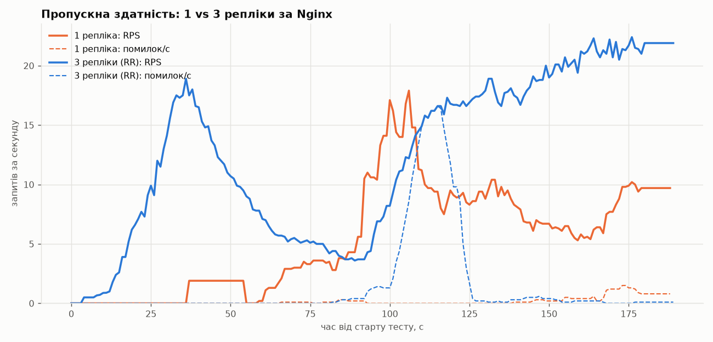
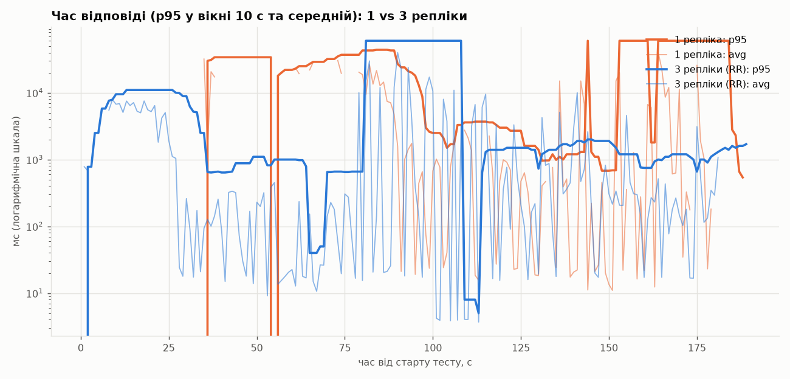
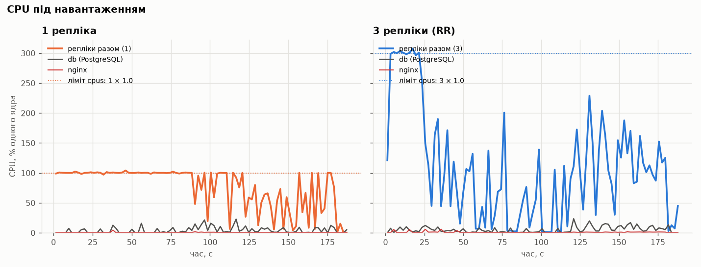

# Multidimensional Portal Generation

## Лабораторна робота №3 — Option B: Cloud Deployment on Render

**Course:** Development of High Workload Applications using Python
**Domain:** Multidimensional Portal Generation (*Генератор багатовимірних порталів*)
**Application class:** Compute-intensive application (*Обчислювально-місткий застосунок*)

This project demonstrates an asynchronous Python application that generates
non-linear three-dimensional geodesic trajectories and renders them in an
interactive HTML5 Canvas dashboard. Lab 3 is implemented using **Option B:
Cloud Deployment on a Free Server (Render)**, rather than a CI/CD pipeline.

## 1. Project and Architectural Overview

The system is a decoupled three-tier architecture:

```text
Browser
   │
   ▼
Django Web Dashboard (:8080)
   │  server-side httpx.AsyncClient proxy
   ▼
FastAPI Calculation API (:8000)
   │  async SQLAlchemy / asyncpg
   ▼
PostgreSQL (:5432, internal Docker network)
```

### Async API layer — FastAPI

The backend is located in `multidimensional-portal-generator/src/`.

- FastAPI exposes authentication, user, and simulation endpoints.
- The `/simulations/run` endpoint validates the request with Pydantic.
- Non-linear coordinate generation is performed by the pure, top-level
  `calculate_secure_coordinates` worker.
- CPU-intensive spatial calculations are submitted to a
  `ProcessPoolExecutor` with `asyncio.get_running_loop().run_in_executor`.
- The event loop remains available for HTTP and database I/O while the
  physics calculation runs in a separate process.
- Coordinates are returned as JSON triplets:

  ```json
  [[x0, y0, z0], [x1, y1, z1], "..."]
  ```

The geodesic worker combines axial displacement, mass-dependent gravitational
drop, dimensional warp harmonics, and depth oscillation. Numerical values are
validated and clamped before serialization.

### Client proxy layer — Django

The client is located in `portal_client/`.

- Django serves the dashboard, login, registration, and HTML templates.
- Browser requests are sent to Django rather than directly to FastAPI.
- Django uses `httpx.AsyncClient` for server-side proxy requests.
- The JWT remains in the Django session and is attached server-side as:

  ```http
  Authorization: Bearer <token>
  ```

- This design avoids browser-to-backend CORS requirements and prevents the
  access token from being exposed to Canvas JavaScript.
- `canvas_sim.js` receives the generated triplets, performs isometric 3D-to-2D
  projection, calculates a dynamic bounding box, and animates the trajectory
  with `requestAnimationFrame`.

### Database and configuration layer

- PostgreSQL 16 is used for persistent application data.
- SQLAlchemy 2.0 asynchronous sessions use the `asyncpg` driver.
- `pydantic-settings` loads environment-specific configuration.
- PostgreSQL data is stored in the named Docker volume `postgres-data`.
- The database container is not published to the host in Compose; application
  services access it through the internal hostname `db`.

## 2. Configuration Management and Environment Profiles

The project replaces hardcoded deployment credentials with environment
variables (*Змінні оточення*). Real environment files are excluded from Git.
Only safe templates are committed:

- `.env.example` — complete local template, including Compose variables.
- `.env.sandbox.example` — sandbox application settings template.
- `.env.production.example` — production settings template.
- `.env.sandbox` — local file created from the sandbox template.
- `.env.production` — deployment/local production file, never committed.

`src/config.py` selects the profile from `ENVIRONMENT` and loads the matching
file:

```python
env_file=f".env.{environment}"
```

Environment variables supplied directly by Docker, Render, or the shell take
precedence over values in the environment file.

### Configuration variables

| Variable | Sandbox example | Production example | Purpose |
|---|---|---|---|
| `ENVIRONMENT` | `sandbox` | `production` | Selects the configuration profile |
| `DEBUG` | `True` | `False` | Enables development diagnostics or production masking |
| `SECRET_KEY` | Local development secret | Strong secret or Render-generated value | JWT signing and application security |
| `ALGORITHM` | `HS256` | `HS256` | JWT signing algorithm |
| `ACCESS_TOKEN_EXPIRE_MINUTES` | `30` | `30` | JWT lifetime |
| `DATABASE_URL` | Internal/local PostgreSQL URL | Managed PostgreSQL connection string | Async SQLAlchemy database connection |
| `PORT` | `8000` | Render-provided `$PORT` | HTTP port used by Uvicorn |

Never commit real passwords, database URLs, JWT secrets, or Render credentials.

### Production error masking

When `DEBUG=False`, the global FastAPI exception handler logs the full
traceback internally but returns only:

```json
{
  "message": "An internal server error occurred."
}
```

This prevents public exposure of internal Python stack traces (*Стектрейси
викликів*) and implementation details. With `DEBUG=True`, detailed exception
messages are available for sandbox diagnostics.

## 3. Database Isolation

Sandbox and production data must use separate PostgreSQL databases and
credentials. Test actions must never run against live production data.

| Environment | Database | Intended use |
|---|---|---|
| Sandbox | `portal_db_sandbox` | Local feature development, experiments, and tests |
| Production | `portal_db_prod` | Isolated Render-managed production workload |

For local Docker Compose, set `POSTGRES_DB=portal_db_sandbox` and make the
database name in `DATABASE_URL` match it. Render provisions
`portal-db-prod` from `render.yaml`; its database name is `portal_db_prod`.

The Compose database is persistent through `postgres-data`, but it remains a
separate local instance from the managed Render database.

## 4. How to Run the Application Locally

### Prepare the sandbox profile

From the repository root:

```bash
cp .env.sandbox.example .env.sandbox
```

Edit `.env.sandbox` and set a local secret and a sandbox-only
`DATABASE_URL`. For Compose, use the complete `.env.example` as a starting
point because it also contains `POSTGRES_USER`, `POSTGRES_PASSWORD`, and
`POSTGRES_DB`:

```bash
cp .env.example .env.sandbox
```

Use a sandbox database such as `portal_db_sandbox`.

### Local Uvicorn launch

The requested profile-oriented commands are:

```bash
# Sandbox
ENV_FILE=.env.sandbox uvicorn src.main:app --host 0.0.0.0 --port 8000 --reload

# Production
ENV_FILE=.env.production uvicorn src.main:app --host 0.0.0.0 --port 8000
```

In the current implementation, profile selection is controlled by
`ENVIRONMENT`, not by `ENV_FILE`. The directly executable equivalents are:

```bash
# Run from multidimensional-portal-generator/
ENVIRONMENT=sandbox uvicorn src.main:app --host 0.0.0.0 --port 8000 --reload
ENVIRONMENT=production uvicorn src.main:app --host 0.0.0.0 --port 8000
```

Ensure `DATABASE_URL`, `SECRET_KEY`, and the appropriate `.env.<environment>`
file are available before starting the API.

The API documentation is then available at:

```text
http://localhost:8000/docs
```

### Docker Compose multi-container launch

The requested commands are:

```bash
# Sandbox
docker compose --env-file .env.sandbox up --build

# Production
docker compose --env-file .env.production up -d --build
```

The Compose file starts:

| Service | Role | Host port |
|---|---|---:|
| `db` | PostgreSQL 16 | Internal `5432` only |
| `backend` | FastAPI and physics worker | `8000` |
| `client` | Django dashboard and proxy | `8080` |

Open the dashboard at:

```text
http://localhost:8080/
```

The client waits for a healthy backend, and the backend waits for a healthy
database. To inspect runtime status:

```bash
docker compose --env-file .env.sandbox ps
docker compose --env-file .env.sandbox logs -f backend client db
```

## 5. Option B — Cloud Deployment on Render

### Infrastructure as Code

`render.yaml` is the Render Infrastructure-as-Code (*Інфраструктура як код*)
blueprint. It defines both the web service and the managed database:

```yaml
services:
  - type: web
    name: portal-generator-api
    env: docker
    plan: free
    dockerfilePath: ./Dockerfile
    healthCheckPath: /health

databases:
  - name: portal-db-prod
    plan: free
    databaseName: portal_db_prod
    user: postgres
```

The blueprint configures production values:

- `ENVIRONMENT=production`
- `DEBUG=False`
- Render-generated `SECRET_KEY`
- `DATABASE_URL` linked automatically to the managed PostgreSQL connection
  string
- `/docs` as the health-check endpoint

### Dynamic port binding

Render assigns the listening port through the `$PORT` environment variable.
The production `Dockerfile` supports both Render and local execution:

```dockerfile
CMD ["sh", "-c", "uvicorn src.main:app --host 0.0.0.0 --port ${PORT:-8000}"]
```

The service binds to the Render-provided port in the cloud and falls back to
port `8000` locally.

### Render deployment steps

1. Push this repository to GitHub.
2. In Render, choose **New → Blueprint**.
3. Connect the repository and select `render.yaml`.
4. Confirm the free web service and PostgreSQL plan.
5. Render builds `Dockerfile`, provisions `portal-db-prod`, generates the
   production secret, and injects the managed connection string.
6. Wait for the `/docs` health check to report the web service as healthy.

The managed database is separate from all sandbox databases. Do not point a
local test profile at the Render production connection string.

### Live public API URL

After deployment, the public API documentation is available at:

```text
https://portal-generator-api.onrender.com/docs
```

The exact hostname may differ if the Render service name is changed. The
Render dashboard is the source of truth for the deployed URL.

## 6. Verification and Testing

Run the backend test suite from the repository root:

```bash
cd multidimensional-portal-generator
../.venv/bin/pytest -q
```

Run static checks:

```bash
.venv/bin/ruff check multidimensional-portal-generator/src \
  multidimensional-portal-generator/tests
node --check portal_client/simulator/static/simulator/js/canvas_sim.js
```

Expected checks include:

- Authentication and role-based access control
- Horizontal IDOR protection
- Rejection of non-finite simulation values
- Non-linear geodesic triplet generation
- Coordinate clamping and JSON-safe output
- Canvas script syntax

## 7. Operational Notes

- Use sandbox credentials and `portal_db_sandbox` for development.
- Use Render-managed secrets and `portal_db_prod` for production.
- Keep `DEBUG=False` in production.
- Do not publish PostgreSQL port `5432` unnecessarily.
- Check container health before debugging the Canvas:

  ```bash
  docker compose ps
  curl -f http://localhost:8000/docs
  curl -f http://localhost:8080/
  ```

- The dashboard proxy logs backend status and response information; the
  Canvas renderer logs payload shape, point count, bounding-box values, scale
  factors, and invalid coordinates in the browser console.

---

## Лабораторна робота 5 — Контейнеризація веб-системи з Docker

**Мета:** запакувати MVP (FastAPI) і базу даних в ізольовані контейнери, оркестрація через
`docker-compose.yml`, персистентні дані БД, запуск усієї системи **однією командою**:

```bash
docker compose up --build
```

### 5.1 Архітектура

```text
                 Host (localhost)
                       │  :8000  (єдиний опублікований порт, WEB_PORT)
┌──────────────────────┼──────────────────────────────────────────────────────────┐
│ docker compose       ▼                     project "portal"                     │
│               ┌──────────────────┐   network: frontend (bridge)                 │
│               │ web              │◄──────────────── client (Django, profile     │
│               │ gunicorn +       │                   "client", :8080, опційно)   │
│               │ uvicorn workers  │                                              │
│               │ user: app (999)  │                                              │
│               └────────┬─────────┘                                              │
│                        │ postgresql+asyncpg://…@db:5432  (DNS-ім'я сервісу "db")  │
│               ┌────────┴─────────┐   network: backend (internal: true —         │
│               │ db               │            без виходу назовні й без портів   │
│               │ postgres:16-alpine│           на хост)                          │
│               └────────┬─────────┘                                              │
│                        │                                                        │
│               volume pgdata ──► /var/lib/postgresql/data                         │
│               (переживає `docker compose down`; видаляється лише `down -v`)      │
└──────────────────────────────────────────────────────────────────────────────────┘
```

Порядок старту: `db` → healthcheck `pg_isready` = healthy → `web` (entrypoint: очікування БД →
`alembic upgrade head` → gunicorn) → healthcheck `GET /health` (виконує `SELECT 1`) = healthy.

### 5.2 Файли та ключові директиви

| Файл | Призначення |
|---|---|
| `Dockerfile` | Multi-stage образ backend |
| `.dockerignore` | Що НЕ потрапляє в build context |
| `docker-compose.yml` | Production-стек: `web` + `db` (+ опційний `client`) |
| `docker-compose.dev.yml` | Dev-оверлей: bind mount коду + `uvicorn --reload` |
| `.env.example` | Шаблон змінних (комітиться); реальний `.env` — у `.gitignore` і `.dockerignore` |
| `docker-entrypoint.sh` | wait-for-db → міграції → `exec` сервера |
| `multidimensional-portal-generator/scripts/prestart.py` | Очікування БД; «усиновлення» старої схеми (stamp) |
| `multidimensional-portal-generator/alembic.ini`, `migrations/` | Alembic, ревізія `0001` — початкова схема |
| `multidimensional-portal-generator/gunicorn.conf.py` | bind `0.0.0.0:$PORT`, `WEB_CONCURRENCY` воркерів `uvicorn_worker.UvicornWorker` |
| `src/main.py` → `GET /health` | 200 `{"status":"ok","database":"ok"}` або 503, якщо БД недоступна |

**Dockerfile**

- `FROM python:3.12-slim` — та сама версія Python, що в розробці й CI; Debian slim (glibc) ставить
  готові manylinux-wheels (`asyncpg`, `bcrypt`, `pydantic-core`) без компіляції; Alpine (musl)
  змусив би компілювати частину залежностей.
- **Stage `builder`**: `gcc` (страховка для платформ без wheels; `libpq-dev` не потрібен — asyncpg
  реалізує протокол PostgreSQL сам), `python -m venv /opt/venv`, `pip install --no-cache-dir`,
  після чого з venv видаляються `pip/setuptools/wheel`.
- **Stage `runtime`**: чистий `python:3.12-slim` + `COPY --from=builder /opt/venv` + код. Компіляторів,
  кешу pip і build-залежностей немає.
- Кешування шарів: спочатку `requirements.txt` → `pip install`, код копіюється останнім — зміна коду
  не перевстановлює залежності.
- `ENV PYTHONDONTWRITEBYTECODE=1 PYTHONUNBUFFERED=1` — без `.pyc`, логи одразу в stdout.
- `USER app` — непривілейований системний користувач (uid 999); код належить root, тобто для
  застосунку лише на читання.
- `EXPOSE 8000`; `ENTRYPOINT ["docker-entrypoint.sh"]`, `CMD ["gunicorn", "src.main:app", "--config", "gunicorn.conf.py"]`
  — gunicorn як менеджер процесів + uvicorn ASGI-воркери, bind `0.0.0.0`.

**docker-compose.yml**

- `name: portal` — фіксоване ім'я проєкту: контейнери `portal-web-1`, `portal-db-1`, том `portal_pgdata`.
- `db`: `postgres:16-alpine`, облікові дані **лише** з `.env` (`env_file`), том `pgdata`, порт **не
  опубліковано** (рядок `ports` закоментовано для налагодження), healthcheck `pg_isready -U … -d …`.
- `web`: `build` з `Dockerfile`; `DATABASE_URL` збирається з тих самих `POSTGRES_*`, хост — ім'я
  сервісу `db`; опубліковано лише `${WEB_PORT:-8000}:8000`; `depends_on: db: condition: service_healthy`;
  healthcheck на `/health` (python urllib — curl у slim-образі немає).
- Мережі: `backend` (`internal: true`) — тільки `web` ↔ `db`, БД не має доступу в інтернет і не
  видна з хоста; `frontend` — опублікований порт `web` і опційний `client`.
- `restart: unless-stopped` для всіх сервісів.
- `client` (Django-дашборд з ЛР 1–3) — під `profiles: ["client"]`, тому `docker compose up` його не
  запускає: `docker compose --profile client up --build`.

**Міграції — entrypoint, а не окремий сервіс `migrate`.** Скрипт виконується в кожному контейнері `web`
перед стартом gunicorn (до форку воркерів, тобто один раз на контейнер): не потрібен окремий
сервіс і `depends_on: service_completed_successfully`, а будь-який запуск образу — compose, Render,
`docker run` — гарантовано отримує актуальну схему. `alembic upgrade head` ідемпотентний: при
повторних стартах він нічого не робить. Обмеження: при кількох репліках `web` міграції краще
винести в one-off сервіс/job, щоб не запускати їх паралельно; вимкнути в контейнері — `RUN_MIGRATIONS=0`.
`prestart.py` додатково чекає БД до 60 с (`DB_WAIT_TIMEOUT`) і, якщо таблиці вже створені старим
`create_all` без `alembic_version`, робить `alembic stamp 0001` замість помилки «relation already exists».

Схемою PostgreSQL тепер керує Alembic; `Base.metadata.create_all` у `startup` залишено лише для
локального запуску на SQLite без Docker. Відповідність міграції моделям перевірено `alembic check`
(`No new upgrade operations detected`).

### 5.3 Запуск і перевірка

```bash
cp .env.example .env        # замініть SECRET_KEY і POSTGRES_PASSWORD (лише URL-безпечні символи)
docker compose up --build   # або з -d --wait, щоб повернути термінал після статусу healthy
```

Очікувано в кінці виводу: `Container portal-db-1 Healthy`, `Container portal-web-1 Started/Healthy`.

```console
$ docker compose ps
NAME           IMAGE                COMMAND                  SERVICE   STATUS                    PORTS
portal-db-1    postgres:16-alpine   "docker-entrypoint.s…"   db        Up 19 seconds (healthy)   5432/tcp
portal-web-1   portal-web:latest    "docker-entrypoint.s…"   web       Up 13 seconds (healthy)   0.0.0.0:8000->8000/tcp
```

`5432/tcp` без `0.0.0.0:` — порт БД не опубліковано на хост.

```console
$ docker compose logs web
web-1  | prestart: database is up (attempt 1)
web-1  | entrypoint: applying migrations (alembic upgrade head)
web-1  | INFO  [alembic.runtime.migration] Context impl PostgresqlImpl.
web-1  | INFO  [alembic.runtime.migration] Will assume transactional DDL.
web-1  | INFO  [alembic.runtime.migration] Running upgrade  -> 0001, Initial schema: users and portal_simulations.
web-1  | entrypoint: schema at revision 0001 (head)
web-1  | [INFO] Starting gunicorn 26.2.0
web-1  | [INFO] Listening at: http://0.0.0.0:8000 (1)
web-1  | [INFO] Using worker: uvicorn_worker.UvicornWorker
web-1  | [INFO] Booting worker with pid: 23
web-1  | [INFO] Booting worker with pid: 24
web-1  | 127.0.0.1:60332 - "GET /health HTTP/1.1" 200
```

На повторних стартах рядка `Running upgrade` немає — схема вже на `0001 (head)`.

**API (створення + читання даних):**

```bash
B=http://localhost:8000; E=lab5@example.com; P='Lab5Password!'
curl -s $B/health
# {"status":"ok","database":"ok"}
curl -s -H 'Content-Type: application/json' -d "{\"email\":\"$E\",\"password\":\"$P\"}" $B/auth/register
# {"id":1,"email":"lab5@example.com","role":"USER","is_active":true}            (HTTP 201)
TOKEN=$(curl -s -H 'Content-Type: application/json' -d "{\"email\":\"$E\",\"password\":\"$P\"}" $B/auth/login \
        | python3 -c 'import sys,json;print(json.load(sys.stdin)["access_token"])')
curl -s -H "Authorization: Bearer $TOKEN" $B/users/me
# {"id":1,"email":"lab5@example.com","role":"USER","is_active":true}            (HTTP 200)
curl -s -H "Authorization: Bearer $TOKEN" -H 'Content-Type: application/json' \
     -d '{"dimension_id":7,"complexity":2,"initial_speed":120.5,"object_mass":42}' $B/simulations/run
# {"id":1,"user_id":1,"coordinates":[[0.0,0.0,33.6], …17 точок…],"created_at":"…"}  (HTTP 201)
docker compose exec db sh -c 'psql -U "$POSTGRES_USER" -d "$POSTGRES_DB" -c "select id,user_id,json_array_length(coordinates),created_at from portal_simulations;"'
```

**Персистентність:**

```bash
docker compose down                    # контейнери й мережі видалено, том — ні
docker volume ls | grep portal_pgdata  # local  portal_pgdata
docker compose up -d --wait
curl -s -H 'Content-Type: application/json' -d "{\"email\":\"$E\",\"password\":\"$P\"}" $B/auth/login
# {"access_token":"…","token_type":"bearer"}  — користувач, створений до down, на місці
docker compose exec db sh -c 'psql -U "$POSTGRES_USER" -d "$POSTGRES_DB" -Atc "select count(*) from portal_simulations;"'
# 1
```

Повне скидання даних — лише явно: `docker compose down -v`.

**Ізоляція (додаткова перевірка):** з хоста `localhost:5432` недоступний; із контейнера `db`
`wget https://pypi.org` → `bad address` (мережа `internal`); `docker compose exec web id` →
`uid=999(app)`.

**Навантажувальні тести ЛР 4** працюють проти цього стеку без змін у сценарії: `host` у
`load-tests/locust.conf` = `http://localhost:8000`, `monitor.py`/`run_test.sh` за замовчуванням
стежать за `portal-web-1`/`portal-db-1` (див. `load-tests/README.md`). Smoke-прогін 5 VU × 30 с:
74 запити, 0 % помилок.

### 5.4 Multi-stage build: розмір образу

```bash
docker images portal-web
```

| Образ | Опис | Розмір |
|---|---|---:|
| `portal-web:before-lab5` | вихідний одностадійний `Dockerfile` (до ЛР 5: без gunicorn/alembic, без gcc, root) | 309 MB |
| `portal-web:single-stage` | ті самі залежності, що й зараз, але одна стадія з `gcc` (як «наївний» Dockerfile) | 547 MB |
| `portal-web:latest` | **multi-stage** (`builder` → `runtime`) | **304 MB** |

Multi-stage прибирає з фінального образу компілятор і build-шари: −243 MB (−44 %) порівняно з
одностадійною збіркою з тими самими залежностями, і навіть трохи менше за вихідний образ, хоча
додано gunicorn, uvicorn-worker і alembic. Більшу частину 304 MB становить сам `python:3.12-slim`;
venv займає ~95 MB (ще можна зменшити, винісши `pytest`/`httpx`/`aiosqlite` у dev-залежності).

Щоб відтворити порівняння:

```bash
git show d9b4247:Dockerfile > /tmp/Dockerfile.before          # останній коміт до ЛР 5
docker build -t portal-web:before-lab5 -f /tmp/Dockerfile.before .
docker build --target builder -t portal-web:builder .          # стадія builder ≈ одностадійний образ з gcc: 565 MB
docker compose build web && docker images portal-web
```

### 5.5 Dev-режим з hot reload

```bash
docker compose -f docker-compose.yml -f docker-compose.dev.yml up --build
```

`docker-compose.dev.yml` для `web`: bind mount `./multidimensional-portal-generator:/app:ro` і
команда `uvicorn src.main:app --host 0.0.0.0 --port 8000 --reload --reload-dir src --reload-dir migrations`.
Entrypoint (міграції) той самий. Файл навмисно **не** названо `docker-compose.override.yml`: той
автоматично підхоплюється звичайним `docker compose up`, а production-стек має лишатися без bind
mounts і reload.

Демонстрація (перевірено):

1. `curl -s localhost:8000/health` → `{"status":"ok","database":"ok"}`.
2. Змінити відповідь `/health` у `src/main.py` і зберегти файл (образ не перезбирається).
3. У логах (`docker compose logs -f web`):
   ```
   WARNING:  StatReload detected changes in 'src/main.py'. Reloading...
   INFO:     Shutting down
   INFO:     Started server process [39]
   ```
4. Через ~2 с `curl` повертає нову відповідь.

Повернення до production: `docker compose -f docker-compose.yml -f docker-compose.dev.yml down && docker compose up -d --build`.

### 5.6 Скріншоти для звіту

1. `docker compose up --build` — кінець збірки (`builder`/`runtime` стадії) і `portal-db-1 Healthy`, `portal-web-1 Started`.
2. `docker compose ps` — обидва сервіси `(healthy)`, опубліковано лише `8000`.
3. `docker compose logs web` — `prestart: database is up`, `Running upgrade -> 0001`, `Starting gunicorn`, воркери.
4. `curl /health` + `register` (201) + `/users/me` (200) + `/simulations/run` (201).
5. Персистентність: `docker compose down` → `docker volume ls` (том є) → `up` → успішний `login` / `select count(*)`.
6. `docker images portal-web` — порівняння розмірів (before / single-stage / multi-stage).
7. Hot reload: лог `StatReload detected changes … Reloading…` і `curl` до/після зміни.
8. (опційно) `docker compose exec web id` → `uid=999(app)`; `.env` у `git status` відсутній (ignored).

---

## Лабораторна робота 6 — Балансування навантаження з Nginx

**Мета:** Nginx як reverse proxy і балансувальник навантаження перед кількома ідентичними репліками
backend, рівномірний розподіл трафіку, відмовостійкість і порівняння продуктивності 1 vs 3 репліки.

### 6.1 Архітектура

```text
 client (curl / browser / Locust)
        │  :80  — єдиний опублікований порт
        ▼
 ┌──────────────┐   network: frontend
 │ nginx:alpine │   nginx.conf (ro) + upstreams/${LB_ALGO}.conf (ro)
 └──────┬───────┘
        │ upstream backend  (round robin | weighted | least_conn | ip_hash)
        │ network: backend (internal: true)
   ┌────┼──────────────┬───────────────┐
   ▼    ▼              ▼               │
 ┌──────────┐   ┌──────────┐   ┌──────────┐      ┌──────────────┐
 │ web1     │   │ web2     │   │ web3     │      │ migrate      │ one-off: alembic upgrade head
 │ gunicorn │   │ gunicorn │   │ gunicorn │      └──────┬───────┘ → exit 0, потім стартують web1..3
 │ 1 worker │   │ 1 worker │   │ 1 worker │             │
 │ 1 CPU    │   │ 1 CPU    │   │ 1 CPU    │             │
 │ 512 MB   │   │ 512 MB   │   │ 512 MB   │             │
 └────┬─────┘   └────┬─────┘   └────┬─────┘             │
      └──────────────┴──────┬───────┴───────────────────┘
                            ▼
                   ┌──────────────────┐
                   │ db               │ postgres:16-alpine ── volume pgdata
                   └──────────────────┘
```

Файли: `docker-compose.lb.yml` (окремий проєкт `portal-lb`, стек ЛР 5 `docker-compose.yml` не змінено),
`nginx/nginx.conf`, `nginx/upstreams/*.conf`, `scripts/rr_test.sh`, `scripts/rr_test.py`,
`scripts/failover_test.sh`, `load-tests/run_lab6_compare.sh`, `load-tests/compare_report.py`,
опційно `docker-compose.replicas.yml` + `nginx/upstreams/dns_replicas.conf`.

### 6.2 Репліки (docker-compose.lb.yml)

- **web1, web2, web3** — явні сервіси з одного YAML-якоря `x-web` / `x-web-env` (без копіювання):
  однаковий образ `portal-web:latest`, `.env`, healthcheck `/health`, ліміти `cpus: 1.0`,
  `mem_limit: 512m` (змінні `WEB_CPUS`, `WEB_MEM`). Відрізняється лише `INSTANCE_NAME`.
  Явні сервіси замість `deploy.replicas` дають стабільні імена в демо (`docker compose stop web2`).
- **Без `ports:` і без `container_name:`** — репліки доступні лише через Nginx у внутрішній мережі.
- **Міграції рівно один раз:** сервіс `migrate` (той самий образ, `RUN_MIGRATIONS=1`, команда
  `echo`) виконує wait-for-db → `alembic upgrade head` і завершується з кодом 0; репліки мають
  `RUN_MIGRATIONS=0` і `depends_on: migrate: condition: service_completed_successfully` — гонки
  трьох `alembic upgrade` за одну таблицю `alembic_version` немає. У логах `web1..3` рядків alembic немає.
- **1 gunicorn-воркер на контейнер** (`WEB_CONCURRENCY: 1`): кожна репліка = один процес, тож
  розподіл у `/whoami` однозначний, а ліміт CPU контейнера відповідає рівно одному воркеру.
  Масштабування відбувається кількістю реплік, а не воркерів.
- **Ідентифікація сервера:**
  - `GET /whoami` → `{"hostname": "1b5d7fbf2ecd", "instance_id": "web1", "pid": 7, "client": "172.21.0.1"}`
    (`socket.gethostname()`, `INSTANCE_NAME`, `os.getpid()`, IP клієнта з `X-Forwarded-For`);
  - middleware додає заголовок `X-Served-By: web1` до кожної відповіді;
  - `FORWARDED_ALLOW_IPS="*"` — gunicorn довіряє `X-Forwarded-*` від Nginx (репліки недоступні ззовні).
- `GET /slow?min_ms=100&max_ms=1000` — запит випадкової тривалості для порівняння алгоритмів
  (блокуючий `sleep`, як bcrypt із ЛР 4: займає єдиний воркер репліки).

### 6.3 Конфігурація Nginx — директиви

| Директива | Значення | Навіщо |
|---|---|---|
| `worker_processes auto` | = кількість ядер | паралельна обробка з'єднань |
| `log_format upstreamlog … $upstream_addr $upstream_status $upstream_response_time $upstream_connect_time` | | у access-лозі видно, яка репліка обробила запит, і всі спроби при failover |
| `include /etc/nginx/upstream.conf` | файл `upstreams/${LB_ALGO}.conf` | алгоритм перемикається змінною, `nginx.conf` не змінюється |
| `resolver 127.0.0.11 valid=5s` + `server webN:8000 resolve` | Docker DNS | IP реплік перечитуються кожні 5 с. **Перевірено:** після `stop/start` web2 отримав новий IP (172.20.0.4 → 172.20.0.7), а старий зайняв інший контейнер — без `resolve` Nginx слав би «web2»-трафік не туди. Також Nginx стартує, навіть якщо репліка лежить |
| `zone backend 64k` | спільна пам'ять | позиція round robin, лічильники помилок і активних з'єднань спільні для всіх worker-процесів Nginx (без неї кожен воркер крутив би свій RR — розподіл не був би 7/7/6) |
| `server … max_fails=2 fail_timeout=10s` | пасивний health check | 2 невдалі спроби за 10 с → сервер виключено на 10 с |
| `keepalive 32` + `proxy_http_version 1.1` + `Connection ""` | | повторне використання TCP-з'єднань до реплік |
| `add_header X-Upstream $upstream_addr always` | | клієнт бачить IP:port репліки (і ланцюжок при retry) |
| `proxy_set_header Host / X-Real-IP / X-Forwarded-For / X-Forwarded-Proto` | | реальний клієнт, хост і схема для застосунку |
| `proxy_connect_timeout 2s` | | мертва репліка виявляється за 2 с |
| `proxy_send_timeout 30s`, `proxy_read_timeout 60s` | | живий, але зайнятий backend (черга bcrypt) має до 60 с — як таймаут клієнта Locust |
| `proxy_next_upstream error timeout http_502 http_503 http_504` | | на яких помилках пробувати наступний сервер (і що вважати «fail» для `max_fails`) |
| `proxy_next_upstream_tries 2`, `proxy_next_upstream_timeout 10s` | | не більше 2 спроб і 10 с на запит |
| `location = /nginx-health` | `return 200` | healthcheck самого Nginx у compose |

Неідемпотентні запити (POST) Nginx за замовчуванням **не** повторює, якщо запит уже дійшов до
backend, — реєстрація чи симуляція не виконається двічі.

### 6.4 Запуск

```bash
docker compose stop                                    # стек ЛР 5 (не обов'язково, але звільняє CPU)
docker compose -f docker-compose.lb.yml up --build -d --wait
docker compose -f docker-compose.lb.yml ps
curl -i http://localhost/whoami
```

```console
NAME                  STATUS                          PORTS
portal-lb-db-1        Up 19 minutes (healthy)         5432/tcp
portal-lb-migrate-1   Exited (0) About a minute ago
portal-lb-nginx-1     Up 5 minutes (healthy)          0.0.0.0:80->80/tcp, [::]:80->80/tcp
portal-lb-web1-1      Up 5 minutes (healthy)          8000/tcp
portal-lb-web2-1      Up 5 minutes (healthy)          8000/tcp
portal-lb-web3-1      Up 5 minutes (healthy)          8000/tcp
```

```console
$ curl -i http://localhost/whoami
HTTP/1.1 200 OK
x-served-by: web1
X-Upstream: 172.20.0.5:8000
{"hostname":"1b5d7fbf2ecd","instance_id":"web1","pid":7,"client":"172.21.0.1"}
```

Порт хоста — `LB_PORT` (за замовчуванням 80). Зупинка: `docker compose -f docker-compose.lb.yml down`
(`-v` — разом із томом).

### 6.5 Round Robin

Round Robin — алгоритм за замовчуванням (жодної директиви в `upstream`): запити по черзі
web1 → web2 → web3 → web1 …, сервери, позначені як недоступні, пропускаються.

```console
$ scripts/rr_test.sh            # або: python3 scripts/rr_test.py
#    HTTP   replica  X-Upstream                       time
1    200    web2     172.20.0.4:8000                  0.006348s
2    200    web3     172.20.0.3:8000                  0.007649s
3    200    web1     172.20.0.5:8000                  0.005410s
4    200    web2     172.20.0.4:8000                  0.005100s
…
20   200    web3     172.20.0.3:8000                  0.009773s
---- summary: 20 requests, non-200: 0
web1       6  ######
web2       7  #######
web3       7  #######
```

Повний вивід: `load-tests/results/lab6_demo_rr.txt`.

### 6.6 Failover і health checks

```bash
scripts/failover_test.sh            # [victim=web2] [stop|kill]; exit 0 = усі перевірки пройдено
```

Скрипт: RR з трьома репліками → `docker compose stop web2` → 20 запитів → логи Nginx →
`docker compose start web2` → очікування healthy (+11 с: DNS 5 с і `fail_timeout` 10 с) → 20 запитів.
Фрагмент реального виводу (повністю — `load-tests/results/lab6_demo_failover.txt`):

```console
=== 3. 20 requests with web2 down (expect only 200, no web2)
#    HTTP   replica  X-Upstream                       time
1    200    web1     172.20.0.5:8000                  0.007701s
2    200    web3     172.20.0.6:8000,172.20.0.3:8000  2.008090s   ← спроба на web2, connect timeout 2 с, retry на web3
3    200    web1     172.20.0.5:8000                  0.005005s
4    200    web3     172.20.0.6:8000,172.20.0.3:8000  2.007509s   ← друга невдача → max_fails=2
5    200    web1     172.20.0.5:8000                  0.004649s
6    200    web3     172.20.0.3:8000                  0.004555s   ← web2 вже виключено
…
---- summary: 20 requests, non-200: 0
web1      10  ##########
web3      10  ##########
OK: all requests succeeded without web2

=== 4. Nginx log lines about the failed upstream
[error] upstream timed out (110: Operation timed out) while connecting to upstream, … upstream: "http://172.20.0.6:8000/whoami"
"GET /whoami HTTP/1.1" 200 78 rt=2.004 upstream=172.20.0.6:8000, 172.20.0.3:8000 ustatus=504, 200 urt=2.002, 0.002
[warn]  upstream server temporarily disabled while connecting to upstream, … upstream: "http://172.20.0.6:8000/whoami"

=== 6. 20 requests after recovery (expect web2 back)
web1       7  #######
web2       6  ######
web3       7  #######
OK: web2 is back in rotation
```

Клієнт не отримав жодної 5xx: Nginx сам повторив запит на іншій репліці (`ustatus=504, 200`); ціна —
+2 с (`proxy_connect_timeout`) для двох запитів, доки спрацював `max_fails`.

**Пасивні vs активні перевірки.** Open-source Nginx має лише **пасивні** health checks: про
несправність він дізнається з реальних клієнтських запитів (помилка/таймаут → лічильник
`max_fails`), а через `fail_timeout` знову пробує сервер «наосліп». **Активні** перевірки
(Nginx сам періодично опитує `/health` і виключає сервер до того, як на нього прийде клієнт) —
директива `health_check` у **Nginx Plus** або сторонні модулі (`nginx_upstream_check_module`,
OpenResty `lua-resty-upstream-healthcheck`); альтернатива — HAProxy/Traefik/Envoy.
Docker healthcheck (`/health` з `SELECT 1`) — **доповнення**: він не впливає на маршрутизацію Nginx
напряму, але керує `depends_on: service_healthy` (Nginx стартує лише після реплік) і показує стан у
`docker compose ps`; разом із `resolve` зупинений контейнер зникає з DNS і за ≤5 с — з upstream.

### 6.7 Альтернативні алгоритми

Перемикання — змінна `LB_ALGO` (монтується `nginx/upstreams/${LB_ALGO}.conf`), репліки не
перезапускаються:

```bash
LB_ALGO=weighted   docker compose -f docker-compose.lb.yml up -d nginx
LB_ALGO=least_conn docker compose -f docker-compose.lb.yml up -d nginx
LB_ALGO=ip_hash    docker compose -f docker-compose.lb.yml up -d nginx
docker compose -f docker-compose.lb.yml up -d nginx          # назад до round_robin
```

| Файл | Алгоритм | Коли застосовувати |
|---|---|---|
| `round_robin.conf` | по черзі | однакові репліки, однакові запити |
| `weighted.conf` | `weight=3/1/1` | репліки різної потужності, canary-реліз |
| `least_conn.conf` | `least_conn;` — найменше активних запитів | дуже різна тривалість запитів |
| `ip_hash.conf` | `ip_hash;` — хеш IP клієнта | «липкі» сесії без cookies |
| `single.conf` | лише web1 | базова лінія для навантажувального порівняння |

**Weighted Round Robin (3:1:1)** — `load-tests/results/lab6_demo_weighted.txt`:

```console
$ LB_ALGO=weighted docker compose -f docker-compose.lb.yml up -d nginx && scripts/rr_test.sh
1 web1, 2 web3, 3 web1, 4 web2, 5 web1, 6 web1, 7 web3, 8 web1, 9 web2, 10 web1, …
---- summary: 20 requests, non-200: 0
web1      12  ############          60 %
web2       4  ####                  20 %
web3       4  ####                  20 %
```

Рівно 60/20/20: Nginx використовує «smooth weighted RR» — web1 не отримує 3 запити поспіль, а
чергується з іншими.

**ip_hash** — `load-tests/results/lab6_demo_ip_hash.txt`: усі 20 запитів з хоста → `web3`
(`web3 20 ####################`). Запити з іншого контейнера (`client: 172.21.0.3`) — теж `web3`:
для IPv4 хешуються лише **перші 3 октети**, а всі клієнти Docker-мережі (і всі клієнти за одним
NAT) лежать в одній /24. Тобто «липкість» є, але рівномірності немає; для реальних сесій краще
`hash $cookie_session consistent` або stateless JWT (як у цьому API — сесій на сервері немає взагалі).

**least_conn vs Round Robin** — 120 запитів `GET /slow` (100–1000 мс, блокуюча робота),
6 паралельних клієнтів, по 2 прогони (`load-tests/results/lab6_demo_least_conn.txt`):

```bash
python3 scripts/rr_test.py --url http://localhost/slow -n 120 -c 6 --quiet
```

| Алгоритм | Розподіл | Throughput, req/s | avg, мс | p95, мс | max, мс |
|---|---|---:|---:|---:|---:|
| round_robin #1 | 40 / 40 / 40 | 4.70 | 1 250 | 2 459 | 3 452 |
| round_robin #2 | 40 / 40 / 40 | 5.11 | 1 139 | 2 312 | 3 396 |
| least_conn #1 | 39 / 42 / 39 | 5.30 | 1 102 | 1 643 | 1 994 |
| least_conn #2 | 41 / 40 / 39 | 5.53 | 1 049 | 1 691 | 1 842 |

Round Robin розподіляє запити рівно 40/40/40 незалежно від того, що репліка ще зайнята довгим
запитом, — нові запити стають у чергу за ним. `least_conn` віддає запит репліці з найменшою
кількістю активних запитів, тож довгі запити не накопичуються на одній: **p95 −30 %, max −45 %,
throughput +8…13 %** при майже тому самому розподілі кількості.

**Варіант з `deploy.replicas` (перевірено):**

```bash
docker compose -f docker-compose.replicas.yml up --build -d --wait     # nginx на :8081
python3 scripts/rr_test.py --url http://localhost:8081/whoami -n 12 --quiet
docker compose -f docker-compose.replicas.yml up -d --scale web=5 --no-recreate --wait
```

Один сервіс `web` з `deploy.replicas: 3`; upstream `server web:8000 resolve;` — Docker DNS
(`127.0.0.11`) повертає IP усіх контейнерів, Nginx робить з кожного A-запису окремий peer. Результат:
3 репліки по 4/4/4 запити, після `--scale web=5` — 5 реплік по 4 запити **без перезавантаження Nginx**.
Мінуси: імена реплік — hostname контейнерів, не можна зупинити одну репліку за іменем сервісу.

### 6.8 Порівняльне навантажувальне тестування: 1 vs 3 репліки

Сценарій — `load-tests/locustfile.py` з ЛР 4 без змін. Профіль — базовий з ЛР 4: **50 VUsers,
spawn 5/с, 3 хв**, `wait_time = between(1, 3)`. Обидва прогони — через той самий Nginx
(`LB_ALGO=single` → лише web1, web2/web3 зупинені; потім `round_robin` → 3 репліки), однакові ліміти
**1 CPU / 512 MB на репліку**, перед кожним прогоном репліки перезапускаються. 100 VUsers не
обрано свідомо: у ЛР 4 навіть необмежений один інстанс при 100 VU колапсував (≈95 % помилок), і
порівнювати колапс з колапсом не має сенсу.

```bash
cd load-tests
./run_lab6_compare.sh 50 5 3m        # → results/lab6_single_*, results/lab6_lb3_* (+ resources, backend logs)
.venv/bin/python compare_report.py   # → results/lab6_compare_*.png, lab6_compare_summary.csv, lab6_compare.md
```

| Метрика | 1 репліка | 3 репліки (RR) | 3 / 1 |
|---|---:|---:|---:|
| Запитів за прогін | 1082 | 2336 | ×2.16 |
| RPS (середнє за тест) | 5.8 | 12.4 | ×2.15 |
| RPS (плато) | 6.3 | 14.1 | ×2.24 |
| **RPS, останні 60 с** | 6.8 | 17.1 | **×2.52** |
| **p95, останні 60 с, мс** | 60 000 | 1 300 | ×0.02 |
| **Помилки, останні 60 с, %** | 6.62 | 0.97 | — |
| Avg, мс | 5 715 | 1 838 | ×0.32 |
| Median, мс | 650 | 24 | ×0.04 |
| p95, мс | 33 000 | 6 000 | ×0.18 |
| p95 на плато, мс | 25 000 | 1 300 | ×0.05 |
| p99 / Max, мс | 60 000 / 60 003 | 60 000 / 60 005 | ×1.00 |
| Помилки за весь тест, % | 7.21 | 12.03 | — |
| CPU реплік разом, avg / max % | 77 / 104 | 108 / 308 | — |
| CPU на одну репліку, avg % | 77 | 36 | — |
| CPU PostgreSQL, avg / max % | 4 / 23 | 5 / 24 | — |
| CPU Nginx, max % | 4.6 | 6.1 | — |
| RAM репліки, max МБ | 171 | 170 | — |

По ендпоінтах (1 репліка / 3 репліки):

| Ендпоінт | Запитів | Avg, мс | p95, мс | Помилок |
|---|---:|---:|---:|---:|
| `/admin/dashboard (expect 403)` | 71 / 161 | 3 237 / 993 | 19 000 / 1 100 | 2 / 26 |
| `/auth/login` | 140 / 207 | 8 399 / 3 590 | 35 000 / 7 500 | 26 / 25 |
| `/auth/register` | 76 / 50 | 30 321 / 8 011 | 37 000 / 12 000 | 26 / 0 |
| `/simulations/run [coordinates]` | 78 / 145 | 3 794 / 2 057 | 27 000 / 2 100 | 3 / 16 |
| `/simulations/run [geodesic]` | 283 / 627 | 2 898 / 2 232 | 13 000 / 3 200 | 7 / 83 |
| `/users/[id]` | 61 / 161 | 3 050 / 770 | 7 300 / 1 900 | 2 / 14 |
| `/users/me` | 373 / 985 | 3 141 / 1 185 | 13 000 / 1 200 | 12 / 117 |





HTML-звіти Locust: `load-tests/results/lab6_single.html`, `load-tests/results/lab6_lb3.html`.

### 6.9 Висновки

1. **Прискорення ×2.2–2.5 за пропускною здатністю** на 3 репліках (×2.16 за кількістю запитів,
   ×2.52 у сталому режимі останніх 60 с), а латентність знизилась на порядок: медіана 650 → 24 мс,
   p95 у сталому режимі ~60 с (таймаути) → 1.3 с, помилки в сталому режимі 6.6 % → 1.0 %.
   Усі 50 реєстрацій на 3 репліках пройшли (0 помилок), на одній — 26 з 76 спроб завершились 502/500.
2. **Де вузьке місце.** На одній репліці — **CPU репліки**: 100 % ліміту (1 ядро) перші ~90 с, поки
   розбирається черга bcrypt-реєстрацій (див. ЛР 4: bcrypt синхронно блокує event loop). На трьох
   репліках CPU усіх трьох упирається в ліміт (300 %) лише під час ramp-up, далі в середньому 36 % на
   репліку. **PostgreSQL (≤ 24 %, у середньому ~5 %) і Nginx (≤ 6 % одного ядра) не є вузьким
   місцем** — запас у них великий. Тобто bottleneck залишився в застосунку (CPU-важка автентифікація
   в одному потоці), просто тепер його «три копії».
3. **Чому менше ніж ×3:**
   - *Закрита модель навантаження.* 50 VUsers з паузою 1–3 с можуть згенерувати щонайбільше
     ~50 / (2 с + latency) ≈ 20–25 RPS; 3 репліки під кінець тесту виходять на ~21 RPS (графік RPS),
     тобто впираються вже в сам генератор навантаження, а не в сервер.
   - *Ramp-up шторм bcrypt.* 50 реєстрацій + 50 логінів за перші 10 с стають у чергу на кожній
     репліці незалежно від кількості реплік; перші ~90 с обидва прогони «розгрібають» цю чергу.
   - *Каскад пасивних health checks.* 265 з 281 помилок 3-реплікового прогону — в одному
     30-секундному вікні (90–120 с): черга bcrypt на всіх репліках одночасно довела частину запитів
     до `proxy_read_timeout` (45× `upstream timed out`), `max_fails=2` тимчасово виключив **усі три**
     живі, але перевантажені репліки (37× `temporarily disabled`), і Nginx 232 рази відповів миттєвим
     `502 no live upstreams`. Це і є причина вищого відсотка помилок «за весь тест» (12 % vs 7 %) —
     швидкі 502 ще й роздувають RPS у цьому вікні. Пасивні перевірки добре ловлять мертву репліку
     (failover-демо), але під перевантаженням виключають здорові сервери.
   - *Oversubscription CPU в контейнері.* `os.cpu_count()` у контейнері = 8, а не 1 (ліміт `cpus`
     — це квота CFS, а не кількість ядер), тож `ProcessPoolExecutor()` у кожній репліці запускає
     **8 процесів** (перевірено: 10 процесів на контейнер = master + worker + 8) на 1 ядро квоти;
     обчислення траєкторій конкурують з event loop і спричиняють throttling.
4. **Наступні кроки:** винести bcrypt з event loop (`run_in_threadpool`) — головний резерв і для
   однієї репліки; обмежити пул `ProcessPoolExecutor(max_workers=…)` за квотою CPU; `least_conn`
   замість RR (див. 6.7 — саме цей профіль «дешеві + дуже дорогі запити»); для `max_fails` не
   рахувати read-timeout перевантаженого сервера (окремий `location` для повільних ендпоінтів з
   власними `proxy_next_upstream`/таймаутами) або активні health checks; генератор навантаження
   на окремій машині й більше VUsers, щоб знайти стелю 3 реплік.

### 6.10 Скріншоти для звіту

1. `docker compose -f docker-compose.lb.yml ps` — db/web1..3/nginx `(healthy)`, `migrate Exited (0)`, опубліковано лише `80`.
2. `docker compose -f docker-compose.lb.yml logs migrate` (міграція один раз) і `curl -i http://localhost/whoami` із заголовками `X-Served-By` / `X-Upstream`.
3. `scripts/rr_test.sh` — 20 запитів і підсумок 7/7/6.
4. `scripts/failover_test.sh` — блоки 3 (усі 200, лише web1/web3, рядки з `2.0s` і двома upstream), 4 (лог Nginx: `upstream timed out`, `temporarily disabled`, `ustatus=504, 200`) і 6 (web2 повернувся).
5. `LB_ALGO=weighted …` + `scripts/rr_test.sh` — 12/4/4.
6. `LB_ALGO=ip_hash …` — 20/20 на одну репліку; `LB_ALGO=least_conn` vs `round_robin` — вивід `rr_test.py … /slow -c 6`.
7. Таблиця порівняння (`load-tests/results/lab6_compare.md` або вивід `compare_report.py`) і три графіки `lab6_compare_*.png`.
8. (опційно) `docker-compose.replicas.yml`: `--scale web=5` і розподіл 5 × 4.
